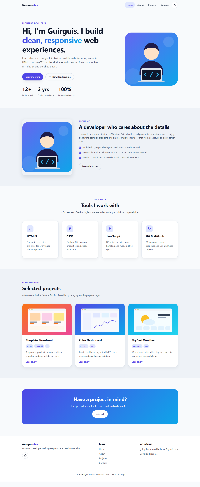
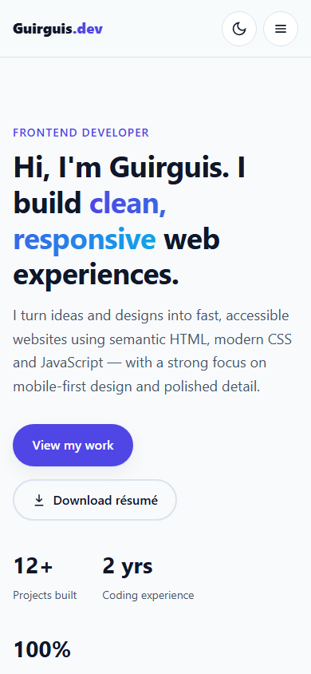
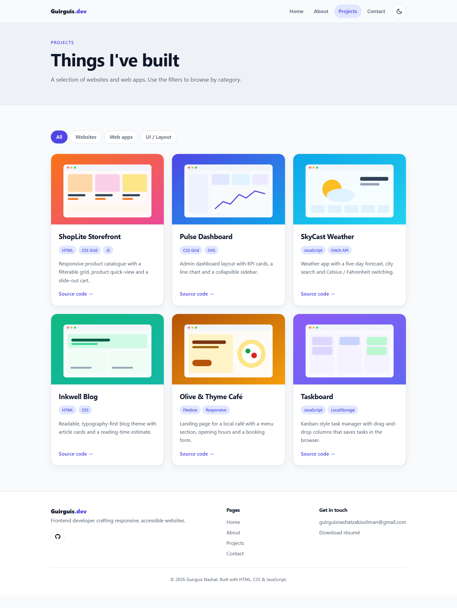
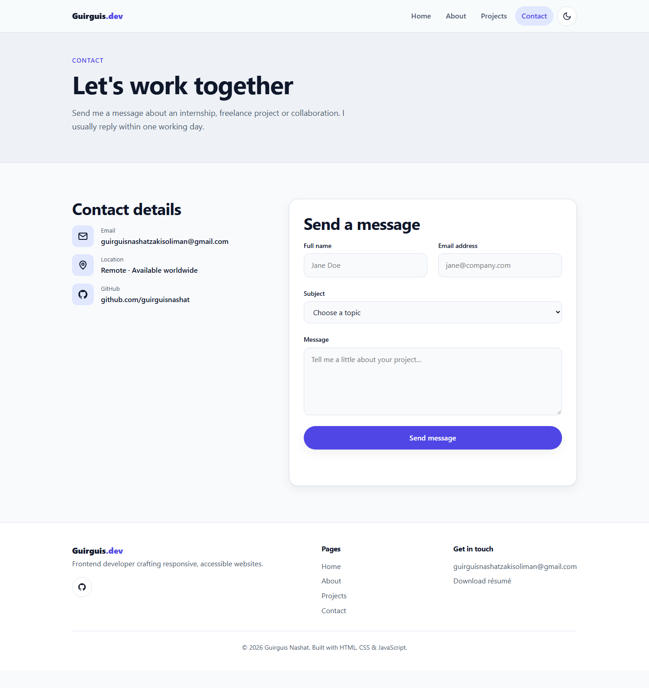

# Task 1 — Professional Portfolio Website

A multi-page, responsive portfolio for a frontend developer. It is built with semantic HTML, a single organised stylesheet and a small vanilla JavaScript file.

**Live demo:** https://guirguisnashat.github.io/Task-1/

## Objective

Present the developer as a capable frontend professional with a clear structure and a polished, consistent UI that works on desktop, tablet and mobile.

## Pages

| Page | Contents |
|------|----------|
| `index.html` (Home) | Hero banner (name, title, intro, CTAs, stats), about preview, tech stack, featured projects, CTA band |
| `about.html` | Profile summary, career interests, skill bars, experience and education timeline, testimonials |
| `projects.html` | Six project cards with **category filters** (All, Websites, Web apps, UI / Layout) |
| `contact.html` | Email, location and social links, plus a validated contact form |

Every page shares the same header, navigation (with the current page highlighted) and footer, which holds the copyright, page links and GitHub profile.

## Features

**Required**
- Semantic elements: `header`, `nav`, `main`, `section`, `article` and `footer`
- Consistent colour palette and type scale built on CSS custom properties
- Mobile-first responsive layout with breakpoints at 640px and 900px
- Flexbox for the navigation, buttons and card internals; CSS Grid for page layouts
- Lightweight SVG images with clean, descriptive file names

**Bonus**
- 🌗 Dark / light mode toggle that follows the system setting and remembers the visitor's choice
- Smooth-scrolling navigation
- Sections that animate into view on scroll (`IntersectionObserver`)
- Project filtering by category
- Résumé download button (`assets/guirguis-nashat-resume.pdf`)
- Accessibility: skip link, visible `:focus-visible` states, alt text, `aria-current`, `aria-pressed`, and `prefers-reduced-motion` support

## Folder structure

```
Task-1/
├── index.html
├── about.html
├── projects.html
├── contact.html
├── css/
│   └── style.css
├── js/
│   └── script.js
└── assets/
    ├── guirguis-nashat-resume.pdf
    ├── images/        # profile illustration + project previews (SVG)
    └── icons/         # favicon.svg
```

## Setup

No build step is needed. Open `index.html` in a browser, or run `python -m http.server` from this folder and visit `http://localhost:8000`.

## Screenshots

| Home (desktop) | Home (mobile) |
|---|---|
|  |  |

| Projects | Contact |
|---|---|
|  |  |

## Author

**Guirguis Nashat**, Web Development Intern at WeIntern Pvt Ltd  
GitHub: [guirguisnashat](https://github.com/guirguisnashat) · Email: guirguisnashatzakisoliman@gmail.com
